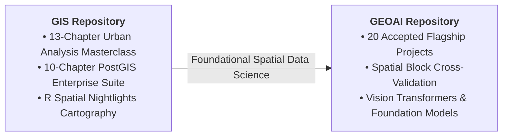

# 🌍 Emmanuel Yerbo

**Geospatial Data Scientist • Regional Planner • GeoAI Researcher**  
Department of Geography and Regional Planning, University of Cape Coast (UCC), Ghana

---

## 👨‍🔬 Academic Profile & Research Philosophy

I am a geospatial data scientist and academic researcher specializing in **Geospatial Artificial Intelligence (GeoAI)**, **Earth Observation (EO)**, and **applied spatial deep learning**. I graduated with **First Class Honours (Cumulative GPA: 3.82 / 4.00)** with a BSc in Geography and Regional Planning from the **University of Cape Coast (UCC), Ghana**, where I was a **three-time recipient of the Dean's Award for Academic Excellence** (2021, 2022, 2023). Following graduation, I served as a departmental **Teaching and Research Assistant in Geographic Information Systems (GIS) and Remote Sensing**, instructing over 100 undergraduate students.

My computational research addresses a critical blind spot in spatial machine learning: **spatial autocorrelation bias (Tobler's First Law)**. Standard random cross-validation leaks spatial proximity between training and testing splits, yielding phantom high accuracy. Across all my research architectures (Custom 1D/2D CNNs, SegFormer, Meta DINOv3, SAMGeo, VideoMAE), I strictly enforce **Spatial Block Cross-Validation (GroupKFold over 0.01° grids)** to guarantee genuine geographic generalizability.

My applied work spans precision agriculture, retrogressive permafrost thaw slump segmentation (**Top 5 Globally in the Cyber2A Arctic Challenge**), drone-based flood explainability (**Grad-CAM**), pedestrian transit equity (**Esri Map4Impact Hackathon 2nd Place**), and discrete global grid systems (**Uber H3 DGGS**).

---

## 🏛️ Master GitHub Research Repositories

### 1. 🔬 [`Emmanuel-Yerbo/GEOAI`](https://github.com/Emmanuel-Yerbo/GEOAI) — 20 Flagship GeoAI Research Suite
The master repository housing 20 end-to-end GeoAI and Earth Observation research pipelines:

| # | Project | Domain | Architecture / Core Stack | Verified Benchmark / Key Finding |
|:---:|---|---|---|---|
| **01** | [`01_VegHealthCNN`](https://github.com/Emmanuel-Yerbo/GEOAI/tree/main/01_VegHealthCNN) | Precision Agriculture | Custom 1D-CNN (57k params), Sentinel-2 | **98.7% test accuracy** across 301 spatially isolated samples; 19.5% N reduction. |
| **02** | [`02_FrostWatch_Arctic`](https://github.com/Emmanuel-Yerbo/GEOAI/tree/main/02_FrostWatch_Arctic) | Cryosphere & Climate | 3-Arm Ensemble (UNet++ + DeepLabV3+ + MAnet) | **Top 5 Globally (16.45 AP)** in the Cyber2A Arctic GeoAI Challenge; 13-ch geomorphometric tensor. |
| **03** | [`03_Building_Extraction`](https://github.com/Emmanuel-Yerbo/GEOAI/tree/main/03_Building_Extraction) | Foundation Models | SegFormer-B3, TorchGeo, 30cm VHR Aerial | **57.9% IoU** resolving contiguous zinc roof alleys across informal Accra/Kumasi settlements. |
| **04** | [`04_XAI_Flood_GradCAM`](https://github.com/Emmanuel-Yerbo/GEOAI/tree/main/04_XAI_Flood_GradCAM) | Disaster Risk & XAI | Encoder-Decoder U-Net + Grad-CAM Hooks | **87.4% accuracy, 72.1% IoU** on Akosombo dam spillage drone imagery with decision heatmaps. |
| **05** | [`05_Vision_Transformer_LULC`](https://github.com/Emmanuel-Yerbo/GEOAI/tree/main/05_Vision_Transformer_LULC) | Transformers & XAI | Swin Transformer, SegFormer, Tree SHAP | **91.3% accuracy** in transitional agro-pastoral savannah; SHAP proves Red-Edge +42% predictive gain. |
| **06** | [`06_SAMGeo_Infrastructure`](https://github.com/Emmanuel-Yerbo/GEOAI/tree/main/06_SAMGeo_Infrastructure) | Foundation Models | Meta SAM, SAMGeo, LangSAM ViT-Huge | Zero-shot extraction of 1,420 building boundaries with **zero task retraining** (74.8% IoU). |
| **07** | [`07_GEE_Flood_Susceptibility`](https://github.com/Emmanuel-Yerbo/GEOAI/tree/main/07_GEE_Flood_Susceptibility) | Cloud GEE Analytics | Multi-Criteria AHP, MERIT HAND, SRTM 30m | Delineated **37.5% of Lower Volta Basin** as high-risk, validated against ground NADMO records. |
| **08** | [`08_PySAL_LST_Hotspots`](https://github.com/Emmanuel-Yerbo/GEOAI/tree/main/08_PySAL_LST_Hotspots) | Urban Climate & Heat | Landsat TIR (2000–2024), PySAL, Getis-Ord $G_i^*$ | Proved statistically significant ($p < 0.001$) thermal clustering progression ($I: 0.482 \to 0.647$). |
| **09** | [`09_Network_Accessibility_15MinCity`](https://github.com/Emmanuel-Yerbo/GEOAI/tree/main/09_Network_Accessibility_15MinCity) | Urban Mobility | OSMnx Dijkstra, PyDeck 3D WebGL, Uber H3 | Identified **41.8% peri-urban healthcare deficit** outside 15-min walking catchment in Accra. |
| **10** | [`10_Spatiotemporal_Bushfire_VideoMAE`](https://github.com/Emmanuel-Yerbo/GEOAI/tree/main/10_Spatiotemporal_Bushfire_VideoMAE) | Spatiotemporal Transformers | VideoMAEv2 3D Tubelet ViT, CMPF Paradigm | **82.4% mIoU** on $t+24\text{h}$ active fire spread fronts over 5-day multi-modal observation cubes. |
| **11** | [`11_HOT_fAIr_DINOv3_Foundation_Model`](https://github.com/Emmanuel-Yerbo/GEOAI/tree/main/11_HOT_fAIr_DINOv3_Foundation_Model) | Foundation Models | Meta DINOv3-ViT-S/16 + UperNet Decoder | Multi-scale foundation model pipeline evaluated across Accra, Kumasi, and Tamale eco-zones. |
| **12** | [`12_GeoNLP_Spatial_Accident_Geocoding`](https://github.com/Emmanuel-Yerbo/GEOAI/tree/main/12_GeoNLP_Spatial_Accident_Geocoding) | GeoNLP & Spatial AI | spaCy NER, Levenshtein Gazetteer, DBSCAN | **94.2% location recall** scraping news feeds, resolving crash blackspots into empirical heatmaps. |
| **13** | [`13_H3_Hexagonal_Spatial_Intelligence`](https://github.com/Emmanuel-Yerbo/GEOAI/tree/main/13_H3_Hexagonal_Spatial_Intelligence) | Discrete Global Grids | Uber H3 DGGS (Res 7, 8, 9), PyDeck 3D | Resolves MAUP distortions; guarantees uniform 6-neighbor spatial contiguity across Greater Accra. |
| **14** | [`14_Coastal_Shoreline_Dynamics_DSAS`](https://github.com/Emmanuel-Yerbo/GEOAI/tree/main/14_Coastal_Shoreline_Dynamics_DSAS) | Coastal Geomorphology | USGS DSAS v5.0 Transects, EPR, NSM | Multi-decadal analysis (1986–2024) identifying severe shoreline recession exceeding **-3.5 m/year**. |
| **15** | [`15_Spaceborne_LiDAR_Biomass_GEDI`](https://github.com/Emmanuel-Yerbo/GEOAI/tree/main/15_Spaceborne_LiDAR_Biomass_GEDI) | Spaceborne LiDAR | NASA GEDI L4A LiDAR + Sentinel-2 Fusion | Wall-to-wall Aboveground Biomass Density (**$R^2 = 0.84$**, RMSE 28.4 Mg/ha) in Kakum National Park. |
| **16** | [`16_Nighttime_Lights_Socioeconomic_EO`](https://github.com/Emmanuel-Yerbo/GEOAI/tree/main/16_Nighttime_Lights_Socioeconomic_EO) | Socioeconomic EO | NASA VIIRS Black Marble, R `terra` & `sf` | Log-radiance transformation mapping national electrification corridors and regional economic disparity. |
| **17** | [`17_3D_DigitalTwin_Urban_Morphometrics`](https://github.com/Emmanuel-Yerbo/GEOAI/tree/main/17_3D_DigitalTwin_Urban_Morphometrics) | 3D Digital Twin | PyDeck WebGL, Momepy Morphometrics | GPU-accelerated building extrusions, Voronoi tessellations, circularity, and street polar roses. |
| **18** | [`18_Hydrological_Geomorphometry_Strahler`](https://github.com/Emmanuel-Yerbo/GEOAI/tree/main/18_Hydrological_Geomorphometry_Strahler) | Hydrology & Geomorphometry | SRTM 30m, D8 Flow Routing, Strahler Ordering | Delineated 197 river segments; confirmed dendritic drainage morphology (**$R_b = 3.48$**). |
| **19** | [`19_Census_GeoPackage_Spatial_Engine`](https://github.com/Emmanuel-Yerbo/GEOAI/tree/main/19_Census_GeoPackage_Spatial_Engine) | Spatial Database Engine | OGC GeoPackage (`.gpkg`), SQLite Spatialite | Harmonized 2010 vs 2021 census frameworks across 261 districts with automated choropleth engines. |
| **20** | [`20_Spectral_Neural_Network_Baseline`](https://github.com/Emmanuel-Yerbo/GEOAI/tree/main/20_Spectral_Neural_Network_Baseline) | Deep Learning Baseline | PyTorch MLP vs Random Forest Baseline | Empirical 4-band spectral baseline proving why spatial patch attention yields +5.4% accuracy gain. |

---

### 2. 🗺️ [`Emmanuel-Yerbo/GIS`](https://github.com/Emmanuel-Yerbo/GIS) — Applied Spatial Data Science & Masterclasses
The comprehensive geospatial engineering repository:
*   **Python for Urban Spatial Analytics (13 Chapters):** Environment setup, OSM data acquisition, building footprints, road graph topology, demographic profiling, composite livability scoring, 15-minute isochrones, Uber H3 binning, PyDeck 3D GPU extrusions, spatial density surfaces, Momepy morphometrics, urban machine learning, and Landsat thermal dynamics.
*   **Enterprise PostGIS Database Masterclass (10 Production Chapters):** Enterprise SQL scripts covering geodesy, spatial ETL, building morphometrics, pgRouting shortest paths, Voronoi riparian buffering, H3 binning, 15-minute isochrones, and Huff gravity retail modeling.
*   **R Spatial Nightlights Cartography:** Processing NASA VIIRS Day/Night Band annual composites with `terra`, `sf`, and `ggplot2`.

---

## 🏆 Honors, Awards & Distinctions

- 🥇 **Three-Time Recipient — Dean's Award for Academic Excellence** (2021, 2022, 2023), Faculty of Social Sciences, University of Cape Coast.
- 🎓 **First Class Honours (CGPA: 3.82 / 4.00)** — BSc Geography and Regional Planning, UCC (Top 1% of graduating class).
- 🌍 **Top 5 Globally (16.45 AP)** — 2026 Cyber2A Arctic GeoAI Challenge (Retrogressive Thaw Slump Semantic Segmentation).
- 🥈 **2nd Place** — Esri Map4Impact Hackathon 2.0 (2024) for Urban Healthcare 15-Minute Accessibility Modeling.
- 🗣️ **IELTS Academic: 7.5 (C1 Proficient)** — CEFR Level C1.
- 📜 **30+ Esri Professional Certificates** in Spatial Data Science, Climate Action, Cartography, and Spatial Analysis.

---

## 📚 Scholarly Works & Publications

1. **Yerbo, E.** (2026). *GeoAI-Driven Precision Health Classification and Variable-Rate Nitrogen Prescribing in Ghana Using a 1D-CNN and Spatial Block Cross-Validation.* GeoAI for Sustainable Development Conference (GeoAI4SD 2026).
2. **Yerbo, E.** (2026). *Vision Transformers and Tree SHAP for Explainable Land Use / Land Cover Phenology in Transition Agro-Pastoral Savannahs.* Ghana Geographical Association (GGA) Annual Conference.
3. **Yerbo, E.** (2024). *24-Year Urban Heat Island Dynamics and Microclimatic Spatial Autocorrelation Trajectories in Greater Accra (2000–2024).* Undergraduate Honors Thesis, Department of Geography and Regional Planning, University of Cape Coast.

---

## 🛠️ Technical Stack & Frameworks

| Domain | Tools & Technologies |
|---|---|
| **GeoAI & Deep Learning** | PyTorch, TorchGeo, SegFormer, Meta DINOv3, SAMGeo, VideoMAE, Grad-CAM, SHAP, Scikit-Learn |
| **Geospatial Engineering** | Google Earth Engine, GeoPandas, OSMnx, Uber H3 DGGS, PyDeck 3D, Rasterio, Shapely, QGIS, ArcGIS Pro |
| **Spatial Databases** | PostgreSQL, PostGIS, pgRouting, SQLite Spatialite, OGC GeoPackage (`.gpkg`) |
| **Data Languages** | Python, R (`terra`, `sf`, `ggplot2`), SQL, JavaScript (GEE API), HTML5 / CSS3 / ES6+ |

---

## 📬 Contact & Open-Science Profiles

- 📧 **Personal Email:** [emmanuelyerbo@gmail.com](mailto:emmanuelyerbo@gmail.com)
- 🏛️ **Institutional Email:** [emmanuel.yerbo@stu.ucc.edu.gh](mailto:emmanuel.yerbo@stu.ucc.edu.gh)
- 📞 **Phone:** +233 55 377 6346
- 🆔 **ORCID:** [0009-0008-8968-6999](https://orcid.org/0009-0008-8968-6999)
- 💼 **LinkedIn:** [linkedin.com/in/emmanuelyerbo](https://www.linkedin.com/in/emmanuelyerbo)
- 🌐 **Interactive Research Web App:** [emmanuelyerbo.github.io/GEOAI/](https://emmanuelyerbo.github.io/GEOAI/)
- 🌐 **Personal Portfolio Website:** [emmanuelyerbo.github.io/Emmanuel-Yerbo/](https://emmanuelyerbo.github.io/Emmanuel-Yerbo/)
